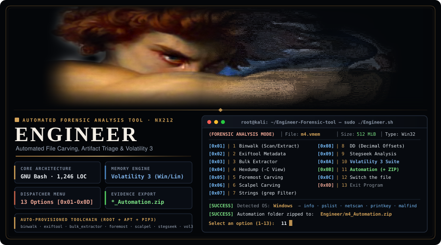
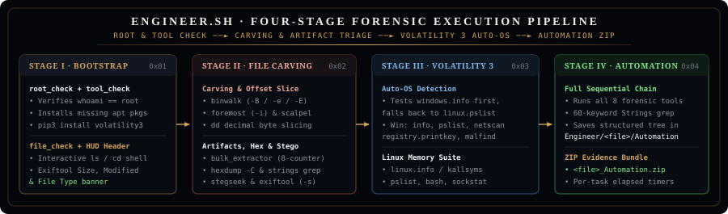
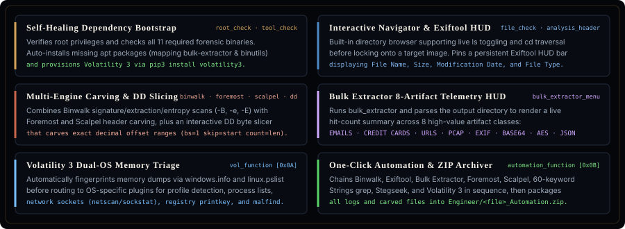
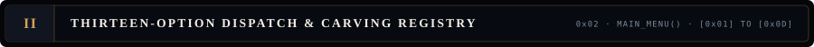
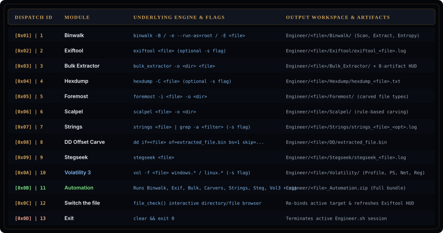
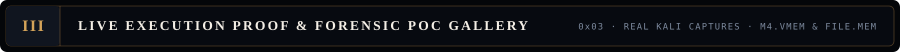
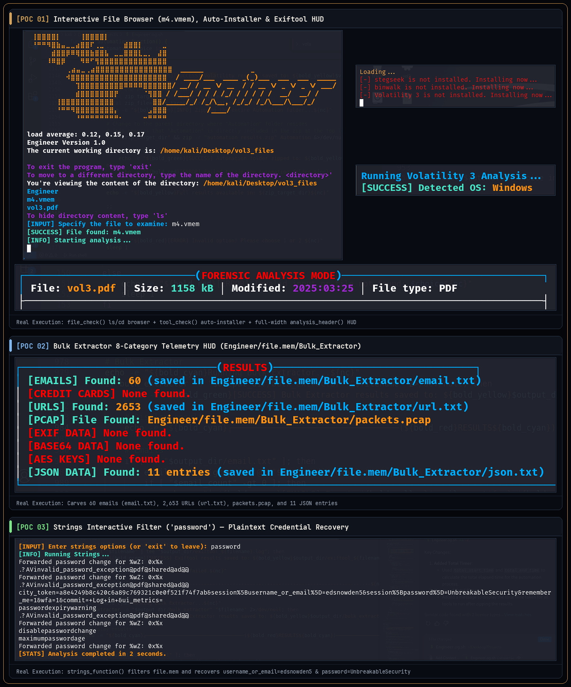
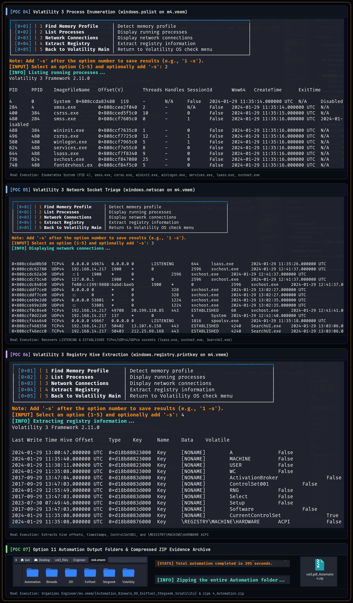
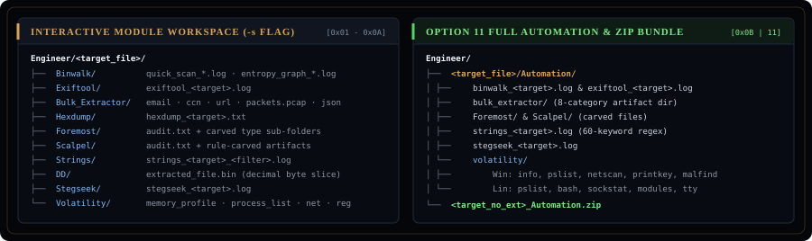

<div align="center">



<br/>

[](Engineer.sh)
[](Engineer.sh)
[](Engineer.sh)
[-56d364?style=for-the-badge&logo=readthedocs&logoColor=white&labelColor=06090e)](docs/Engineer_Portfolio.pdf)

</div>

<p align="center">
  
</p>

<p align="center">
  
  
</p>

<p align="center">
  
  
</p>

<p align="center">
  
  
  
</p>

<p align="center">
  
</p>

```bash
git clone https://github.com/ArtistS24/Engineer-Forensic-tool.git
cd Engineer-Forensic-tool
chmod +x Engineer.sh

sudo ./Engineer.sh
```

<p align="center">
  
</p>

<div align="center">

[](https://github.com/volatilityfoundation/volatility3)
[](https://github.com/ReFirmLabs/binwalk)
[](https://github.com/simsong/bulk_extractor)
[](https://github.com/sleuthkit/scalpel)
[](https://github.com/RickdeJager/stegseek)
[](https://github.com/exiftool/exiftool)

</div>
